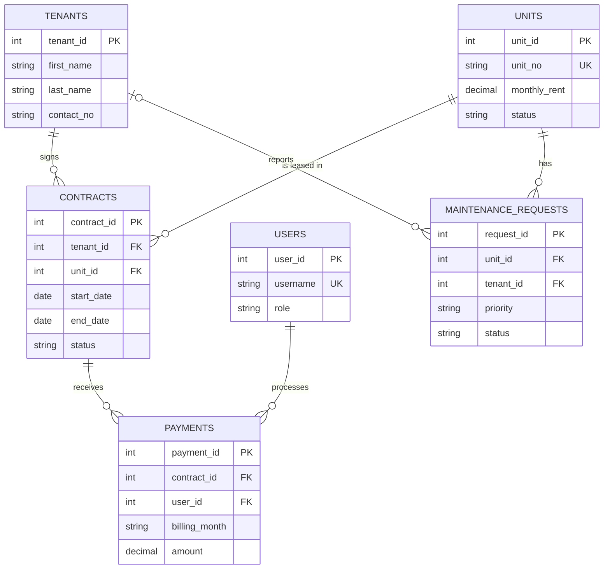

# Apartment Rental Management System: System Overview

## 1. Purpose
A Java desktop application that helps an apartment owner or staff manage **units, tenants, lease contracts, rent payments and maintenance requests** in one place, replacing paper records and spreadsheets.

It was built for the course requirement (Group 2, Topic #19): a Swing/AWT GUI connected to an Apache Derby database through JDBC, with validated CRUD, search, foreign-key relationships, JOIN queries, error handling, login/logout, role-based access and reports.

## 2. Technology
| Layer | Technology |
|---|---|
| Language | Java |
| User interface | Swing / AWT |
| Database access | JDBC (`PreparedStatement` everywhere) |
| Database | Apache Derby (Java DB), network server on port 1527 |
| IDE | NetBeans (Ant project) |
| Version control | Git / GitHub |

## 3. Users and roles
| Role | Can do |
|---|---|
| **Admin** | Everything: all modules, delete records, manage user accounts, view reports |
| **Staff** | Create and edit units, tenants, contracts, payments and maintenance requests. **Cannot** delete records or open User Management |

Passwords are stored as SHA-256 hashes, never as plain text. A default account (`admin` / `admin123`) is created on first run.

## 4. Architecture
The application is layered. Each layer has one job.

```
User → Swing Frame (ui) → Validation → DAO (dao) → JDBC → Apache Derby → Tables
User ← Swing Frame (ui) ← List<Model> ← DAO ←────────────────────────────┘
```

| Layer | Package | Responsibility |
|---|---|---|
| UI | `ui` | Screens. Reads input, validates, shows messages. **No SQL.** |
| DAO | `dao` | All SQL. Throws `SQLException`. **No dialogs.** |
| Model | `model` | Plain data classes (getters/setters only) |
| Database | `database` | Connection and first-run setup |
| Utilities | `util` | `Session`, `Validator`, `ErrorHelper`, `PasswordUtil`, `TableHelper`, `Constants`, `Style` |

## 5. Modules
| Module | What it does |
|---|---|
| **Login / Dashboard** | Secure login (masked password), summary cards (units, occupied, active contracts, rent collected, open requests), menu to every module, logout |
| **Users** | Add, edit, deactivate accounts; assign Admin or Staff; protects the last Admin |
| **Units** | Apartment units with type, floor, monthly rent and status (Available, Occupied, Maintenance) |
| **Tenants** | Tenant profiles with contact details and their current unit |
| **Contracts** | Leases linking one tenant to one unit with dates, rent and deposit; ending a contract frees the unit |
| **Payments** | Monthly rent payments against active contracts; void instead of delete; shows who received the payment |
| **Maintenance** | Repair requests per unit (and optionally per tenant) with priority, status, resolution date and repair cost |
| **Reports** | Unit occupancy, tenant list, monthly rent collection, overdue rent, open maintenance, contracts expiring soon |

Every data module supports **Add, View (table), Search, Update, Delete (with confirmation) and Clear**, with friendly error messages.

## 6. Database design
Six tables with primary keys, foreign keys and CHECK constraints. IDs are auto-generated identity columns.



| Relationship | Meaning |
|---|---|
| Tenants 1 : M Contracts | A tenant can have many contracts over time |
| Units 1 : M Contracts | A unit can be leased many times, but only one contract is Active at a time |
| Contracts 1 : M Payments | A contract has many monthly payments |
| Users 1 : M Payments | A staff user processes many payments |
| Units 1 : M Maintenance requests | A unit can have many repair requests |
| Tenants 1 : M Maintenance requests | Optional: management can also create requests |

## 7. Key business rules
- **Creating a contract** inserts the contract and sets the unit to *Occupied* in **one transaction**. If either step fails, both are undone.
- Only **Available** units can be leased. The update also checks the status, so two people cannot lease the same unit at once.
- **Ending or terminating** a contract sets its status and frees the unit (back to *Available*), again in one transaction.
- Each contract keeps its **own monthly rent**, so changing a unit's rent later does not alter existing contracts.
- Payments only apply to **Active** contracts. Financial records are **voided**, not deleted.
- Units and tenants with contract or maintenance history **cannot be deleted**.
- The Maintenance module never changes a unit's status; occupancy is controlled only by Contracts.
- The user who records a payment is taken from the **logged-in session**, never typed in.

## 8. Typical workflow
1. Admin logs in and creates staff accounts.
2. Units and tenants are registered.
3. A contract is created, so the unit becomes **Occupied**.
4. Staff record monthly **payments**; the dashboard totals update.
5. Tenants or management report **maintenance** problems; staff track them until resolved.
6. When the lease finishes, the contract is **ended** and the unit is **Available** again.
7. Reports show occupancy, collections and overdue rent.

## 9. Project structure
```
ApartmentRental/
  sql/        schema.sql, sample_data.sql, drop_all.sql
  src/
    Main.java
    model/    User, Unit, Tenant, Contract, Payment, MaintenanceRequest, ComboItem
    dao/      UserDAO, UnitDAO, TenantDAO, ContractDAO, PaymentDAO, MaintenanceDAO, DashboardDAO, ReportDAO
    database/ DatabaseConnection, DatabaseInitializer, ConnectionTest
    util/     Session, Validator, ErrorHelper, PasswordUtil, TableHelper, Constants, Style
    ui/       Login, Dashboard, User, Unit, Tenant, Contract, Payment, Maintenance, Reports frames
    tests/    CrossModuleTest, GuiSmokeTest
```

## 10. Team responsibilities
| Member | Area |
|---|---|
| Member 1 | Database, shared code, Maintenance module, project setup, final integration |
| Member 2 | Login, Dashboard, Users, role-based access, Reports |
| Member 3 | Units and Tenants |
| Member 4 | Contracts and Payments |

## 11. Current status
| Item | Status |
|---|---|
| Database schema, sample data, connection | Done and tested |
| Shared utility classes | Done |
| Login, Dashboard, Users, Reports | Built (integration version) |
| Units, Tenants | Built (integration version) |
| Contracts, Payments | Built (integration version), with transactions |
| Maintenance | Built |
| Cross-module test | 14 of 15 steps automated and passing; step 15 (stop Derby) is manual |

## 12. How to run
1. Start the Derby server (NetBeans: Services, Databases, Java DB, Start Server).
2. Create the database (`apt_db`, user `app`, password `app`) and run `sql/schema.sql`, then `sql/sample_data.sql`.
3. Add `derbyclient.jar` (and `derbyshared.jar` for Derby 10.15+) to the project libraries.
4. Run `database/ConnectionTest.java` to confirm the connection, then run `Main.java`.

See `README.md` and `DERBY_TUTORIAL.md` for full setup steps.
